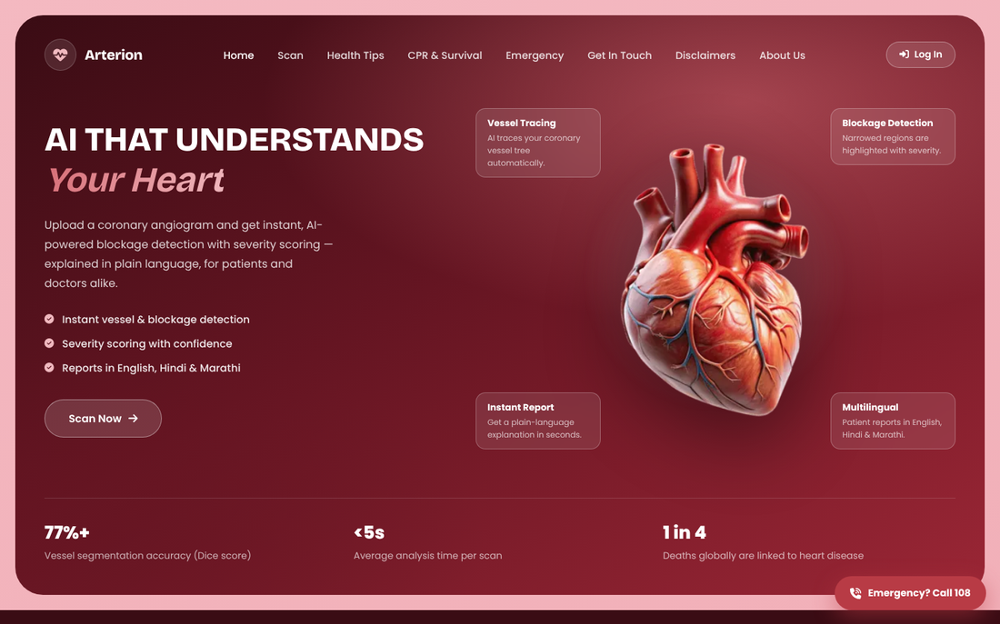
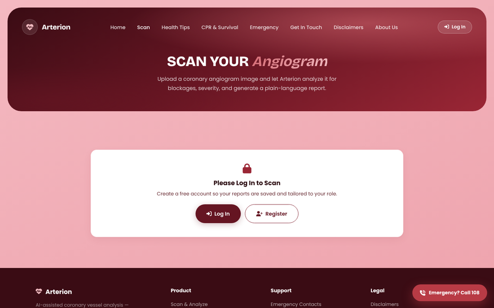
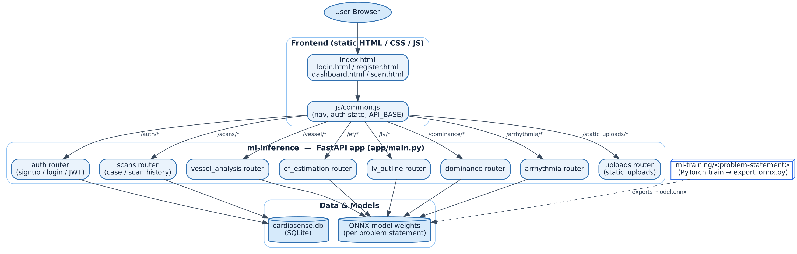

# Arterion — AI That Understands the Heart

Arterion (built as **CardioSense**) is a full-stack cardiac AI platform: a FastAPI backend serving five independent deep-learning models, a static multi-page frontend for patients and clinicians, and a standalone `ml-training/` workspace where each model is trained and exported. Originally built for the Synapse Hackathon (Symbiosis Pune, AI in Healthcare track).

## Screenshots

| Home | Login | Scan |
|---|---|---|
|  |  |  |

## Architecture



The frontend talks to a single FastAPI service over REST. Each cardiac problem statement is its own router, loading its own ONNX model from `ml-inference/app/<problem_statement>/weights/`. Scans and user data persist to a local SQLite database; trained weights are produced separately in `ml-training/` and exported as ONNX for inference.

## Features

- **Email/password auth** with JWT sessions, used across the dashboard and scan upload flow
- **Scan upload & history** — users upload cardiac imaging/ECG data and track past scans per account
- **Five independent ML models behind one API**:
  - Coronary vessel & stenosis segmentation (angiogram images)
  - Ejection fraction (EF) estimation (echocardiogram video)
  - Left ventricle outline / segmentation (echocardiogram frame)
  - Cardiac dominance classification (angiogram images)
  - Arrhythmia classification (ECG beat + RR-interval features)
- **Patient-facing pages** beyond the core app: emergency contacts, CPR survival guide, health suggestions, disclaimers, and a developer/about page
- **Dockerized** — one `docker-compose up` runs the full stack (FastAPI + nginx-served frontend)
- **One-command local run** on Windows via `run.ps1` — no manual venv/port juggling

## Tech Stack

| Layer | Technology |
|---|---|
| Backend | FastAPI, Python 3.11, SQLite, JWT auth |
| ML inference | ONNX Runtime (models exported from PyTorch) |
| ML training | PyTorch, torchvision, OpenCV, albumentations |
| Frontend | Static HTML/CSS/vanilla JS, served via nginx in production |
| Deployment | Docker, Docker Compose |

## Quick Start

### Option A — Docker Compose (fastest)

```bash
docker compose up --build
```

- Frontend: http://localhost:8080
- API: http://localhost:8000

### Option B — One-command Windows launcher

```powershell
.\run.ps1
```

Sets up the backend virtual environment on first run, starts the FastAPI backend and a static frontend server, and opens the app in your default browser.

### Option C — Manual

```bash
# Backend
cd ml-inference
python -m venv venv
venv\Scripts\activate        # or source venv/bin/activate on Linux/Mac
pip install -r requirements.txt
uvicorn app.main:app --reload

# Frontend (separate terminal)
cd frontend
python -m http.server 5500
```

Each problem statement's trained model is picked up automatically once its `model.onnx` and supporting files are copied into `ml-inference/app/<problem_statement>/weights/`.

## Training a model from scratch

```bash
cd ml-training/<problem-statement>
python -m venv venv
venv\Scripts\activate
# install torch/torchvision separately, matching your exact GPU — see that PS's IMPLEMENTATION.md
pip install -r requirements.txt
```

Follow that folder's `IMPLEMENTATION.md` phase by phase, then export to ONNX and drop the result into `ml-inference/app/<problem_statement>/weights/`.
