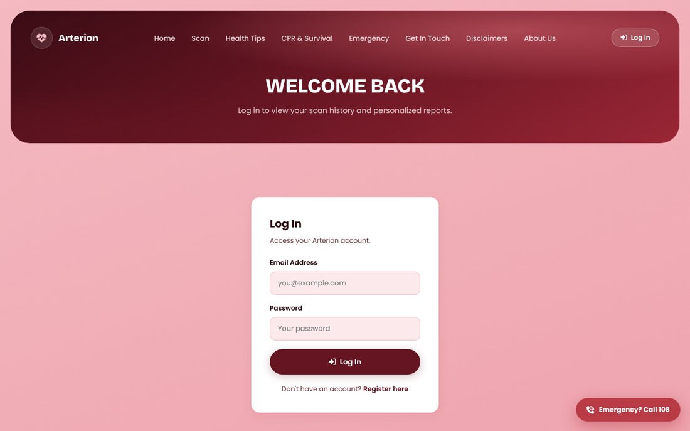

# Arterion — AI That Understands the Heart

Arterion (built as **CardioSense**) is a full-stack cardiac AI platform: a FastAPI backend serving five independent deep-learning models, a static multi-page frontend for patients and clinicians, and a standalone `ml-training/` workspace where each model is trained and exported. Originally built for the Synapse Hackathon (Symbiosis Pune, AI in Healthcare track).

## Table of Contents

- [Screenshots](#screenshots)
- [Features](#features)
- [Tech Stack](#tech-stack)
- [Quick Start](#quick-start)
- [Training a model from scratch](#training-a-model-from-scratch)
- [ML Models](#ml-models)
- [Project Structure](#project-structure)
- [Credits](#credits)

## Screenshots

| Home | Login | Scan |
|---|---|---|
|  |  |  |

The frontend talks to a single FastAPI service over REST. Each cardiac problem statement is its own router, loading its own ONNX model from. Scans and user data persist to a local SQLite database; trained weights are produced separately in `ml-training/` and exported as ONNX for inference.

## Features

- **Email/password auth** with JWT sessions, used across the dashboard and scan upload flow
- **Scan upload & history** — users upload cardiac imaging/ECG data and track past scans per account
- **Five independent ML models behind one API**:
  - Coronary vessel & stenosis segmentation (angiogram images)
  - Ejection fraction (EF) estimation (echocardiogram video)
  - Left ventricle outline / segmentation (echocardiogram frame)
  - Cardiac dominance classification (angiogram images)
  - Arrhythmia classification (ECG beat + RR-interval features)
- **Patient-facing pages** beyond the core app: emergency contacts, CPR survival guide, health suggestions, disclaimers, and a developer/about page
- **Dockerized** — one `docker-compose up` runs the full stack (FastAPI + nginx-served frontend)
- **One-command local run** on Windows via `run.ps1` — no manual venv/port juggling

## Tech Stack

| Layer | Technology |
|---|---|
| Backend | FastAPI, Python 3.11, SQLite, JWT auth |
| ML inference | ONNX Runtime (models exported from PyTorch) |
| ML training | PyTorch, torchvision, OpenCV, albumentations |
| Frontend | Static HTML/CSS/vanilla JS, served via nginx in production |
| Deployment | Docker, Docker Compose |

## Quick Start

### Option A — Docker Compose (fastest)

```bash
docker compose up --build
```

- Frontend: http://localhost:8080
- API: http://localhost:8000

### Option B — One-command Windows launcher

```powershell
.\run.ps1
```

Sets up the backend virtual environment on first run, starts the FastAPI backend and a static frontend server, and opens the app in your default browser.

### Option C — Manual

```bash
# Backend
cd ml-inference
python -m venv venv
venv\Scripts\activate        # or source venv/bin/activate on Linux/Mac
pip install -r requirements.txt
uvicorn app.main:app --reload

# Frontend (separate terminal)
cd frontend
python -m http.server 5500
```

Each problem statement's trained model is picked up automatically once its `model.onnx` and supporting files are copied into `ml-inference/app/<problem_statement>/weights/`.

## Training a model from scratch

```bash
cd ml-training/<problem-statement>
python -m venv venv
venv\Scripts\activate
# install torch/torchvision separately, matching your exact GPU — see that PS's IMPLEMENTATION.md
pip install -r requirements.txt
```

Follow that folder's `IMPLEMENTATION.md` phase by phase, then export to ONNX and drop the result into `ml-inference/app/<problem_statement>/weights/`.

## ML Models

Metrics below are from each model's held-out test set (see `ml-training/<problem-statement>/artifacts/metrics*.json`). Dominance classification is code-complete but not yet trained on the full dataset.

| Problem statement | Model | Params | Test set | Key metrics |
|---|---|---|---|---|
| Vessel segmentation | VesselUNet (ResNet34 encoder) | 24.4M | 300 images | Dice 0.774, IoU 0.644, precision 0.832, recall 0.743 |
| Stenosis segmentation | VesselUNet (ResNet34 encoder) | 24.4M | 300 images | Dice 0.575, IoU 0.428, precision 0.561, recall 0.683 |
| Ejection fraction estimation | R(2+1)D-18 regressor | 31.3M | 1,277 clips | MAE 5.13, RMSE 6.95, R² 0.676 |
| Left ventricle outline | LVUNet (ResNet34 encoder) | 24.4M | 2,552 frames | Dice 0.925, IoU 0.863, precision 0.923, recall 0.933 |
| Arrhythmia classification | CardioNet (1D ResNet + RR features) | 498K | MIT-BIH, inter-patient split | Accuracy 0.981 (macro-F1 is low — minority arrhythmia classes have very few test examples in the inter-patient split) |
| Cardiac dominance classification | — | — | — | In progress — code-complete, not yet trained on the full dataset |

## Project Structure

```
arterion/
├── frontend/              # Static multi-page site (HTML/CSS/JS), served via nginx in prod
├── ml-inference/          # FastAPI service — one router per problem statement
│   └── app/
│       ├── auth/          # JWT auth
│       ├── scans/         # Scan upload & history
│       ├── vessel_analysis/
│       ├── ef_estimation/
│       ├── lv_outline/
│       ├── dominance/
│       └── arrhythmia/
├── ml-training/           # One self-contained folder per problem statement
│   └── <problem-statement>/
│       ├── PRD.md / IMPLEMENTATION.md / STATUS.md
│       ├── src/
│       └── artifacts/     # Trained weights + metrics (gitignored except ONNX export + metrics.json)
├── docs/                  # Screenshots (this README)
├── docker-compose.yml
└── run.ps1                # One-command Windows launcher
```

## Credits

Built by Kartik Pagariya for the Synapse Hackathon (Symbiosis Pune, AI in Healthcare track).
